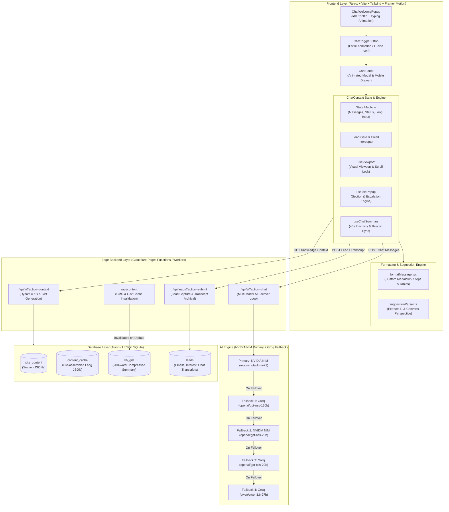
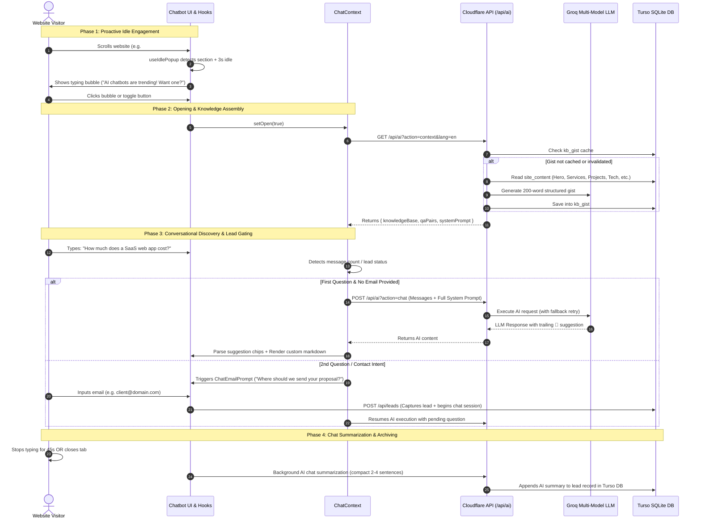

# ORBIT SaaS AI Chatbot — Full Architecture & Implementation Blueprint (A–Z)

This document is an exhaustive, production-grade architectural specification and replication blueprint for the conversational AI chatbot from the **ORBIT SaaS** platform. It contains all system diagrams, data pipelines, edge functions, database schemas, frontend state machines, UX hooks, and step-by-step instructions needed to implement an identical chatbot on any other website.

---

## Table of Contents
1. [High-Level Architecture & System Topology](#1-high-level-architecture--system-topology)
2. [End-to-End Runtime Sequence Flow](#2-end-to-end-runtime-sequence-flow)
3. [Complete Codebase Directory Map](#3-complete-codebase-directory-map)
4. [Subsystem Deep Dives](#4-subsystem-deep-dives)
   - [4.1 Multi-Model AI Engine & Failover](#41-multi-model-ai-engine--failover)
   - [4.2 Dynamic Knowledge Base & Gist Generation](#42-dynamic-knowledge-base--gist-generation)
   - [4.3 Proactive Engagement & Escalation Engine](#43-proactive-engagement--escalation-engine)
   - [4.4 Suggestion Parser & Perspective Converter](#44-suggestion-parser--perspective-converter)
   - [4.5 Custom Markdown & Table Formatter](#45-custom-markdown--table-formatter)
   - [4.6 Lead Gating & Inactivity Summarizer](#46-lead-gating--inactivity-summarizer)
   - [4.7 Mobile Viewport & Virtual Keyboard Handler](#47-mobile-viewport--virtual-keyboard-handler)
   - [4.8 Admin CMS & Knowledge Cache Invalidation](#48-admin-cms--knowledge-cache-invalidation)
5. [Database Schema (LibSQL / SQLite / PostgreSQL)](#5-database-schema)
6. [Step-by-Step Blueprint to Replicate in a New Project](#6-step-by-step-blueprint-to-replicate-in-a-new-project)

---

## 1. High-Level Architecture & System Topology



---

## 2. End-to-End Runtime Sequence Flow



---

## 3. Complete Codebase Directory Map

```
├── backend/
│   ├── functions/
│   │   ├── _lib/
│   │   │   ├── db.ts           # Turso LibSQL client connector (@libsql/client/web)
│   │   │   ├── cors.ts         # CORS handler & standard jsonResponse wrapper
│   │   │   ├── auth.ts         # JWT admin authorization verification
│   │   │   ├── mail.ts         # Automated welcome emails via SMTP / Brevo / SendGrid
│   │   │   └── types.ts        # Cloudflare Env interface bindings
│   │   └── api/
│   │       ├── ai.ts           # /api/ai: Handles chat, context gist, and copy enhance
│   │       ├── leads.ts        # /api/leads: Lead capture, summary appending, visitor analytics
│   │       └── content.ts      # /api/content: Site CMS, content cache & kb_gist invalidation
│
└── frontend/
    └── src/
        ├── services/
        │   └── aiService.ts     # Client fetch wrapper for /api/ai?action=chat
        └── components/
            └── orbit/
                └── chatbot/
                    ├── Chatbot.tsx              # Root wrapper with ChatProvider
                    ├── ChatContext.tsx          # Central state, lead gate, and AI dispatcher
                    ├── types.ts                 # ChatMessage, Lang, UserMode, ContextMessage
                    ├── constants.ts             # Proactive messages mapped by section & mode
                    ├── components/
                    │   ├── ChatPanel.tsx        # Framer Motion animated modal container
                    │   ├── ChatHeader.tsx       # Header, status pill, language menu, clear chat
                    │   ├── ChatMessageList.tsx  # Message stream, welcome language selector, dots
                    │   ├── ChatMessageBubble.tsx# Individual bubbles + [SUGGEST_SWITCH] button
                    │   ├── ChatEmailPrompt.tsx  # Lead capture email card
                    │   ├── ChatInput.tsx        # Keyboard input + send button
                    │   ├── ChatSuggestionChips.tsx # Suggestion chips row
                    │   ├── ChatToggleButton.tsx # Floating trigger (Lottie or Lucide Icon)
                    │   └── ChatWelcomePopup.tsx # Typewriter speech bubble
                    ├── hooks/
                    │   ├── useIdlePopup.ts      # Proactive behavioral engagement engine
                    │   ├── useChatSummary.ts    # Background AI summarizer & tab beacon
                    │   └── useViewport.ts       # Visual viewport tracker & body scroll lock
                    └── utils/
                        ├── knowledgeBase.ts     # Dynamic KB fetcher & system prompt builder
                        ├── suggestionParser.ts  # Extracts 💬 lines & converts perspective
                        ├── formatMessage.tsx    # Fast Markdown/Table/Step parser
                        └── sectionDetection.ts  # Viewport intersection & user behavior mode
```

---

## 4. Subsystem Deep Dives

### 4.1 Multi-Model AI Engine & Failover
Implemented in `backend/functions/api/ai.ts`:
- **1st Model (Primary)**: Moonshot AI Kimi K3 on **NVIDIA NIM** (`moonshotai/kimi-k3` via `https://integrate.api.nvidia.com/v1/chat/completions`)
- **Fallback Models**:
  1. `openai/gpt-oss-120b` on Groq (ultra-fast, high-reasoning open model)
  2. `openai/gpt-oss-20b` on NVIDIA NIM
  3. `openai/gpt-oss-20b` on Groq
  4. `qwen/qwen3.6-27b` on Groq
- **Failover Logic**:
  If the primary model returns a `429 (Rate Limit)`, `500 (Internal Error)`, empty content, or times out (`AbortSignal.timeout(15000)`), the edge worker catches the exception, logs a warning, and automatically attempts the next fallback model in the candidate chain before throwing an error.

```typescript
// Multi-candidate execution loop with NVIDIA NIM primary & Groq fallback
for (const candidate of candidateList) {
    const apiKey = candidate.getApiKey(env);
    if (!apiKey) continue;

    try {
        const res = await fetch(candidate.url, {
            method: 'POST',
            headers: {
                'Content-Type': 'application/json',
                'Authorization': `Bearer ${apiKey}`,
            },
            body: JSON.stringify({
                model: candidate.model,
                messages,
                temperature: options.temperature,
                max_tokens: options.max_tokens,
            }),
            signal: AbortSignal.timeout(candidate.timeoutMs),
        });

        if (res.ok) {
            const data = await res.json();
            const content = data.choices?.[0]?.message?.content?.trim();
            if (content) {
                return { content, source: candidate.source, model: candidate.model };
            }
        }
    } catch (err) {
        // Continue to fallback model
    }
}
```

---

### 4.2 Dynamic Knowledge Base & Gist Generation
Implemented in `backend/functions/api/ai.ts` & `frontend/src/components/orbit/chatbot/utils/knowledgeBase.ts`:
- Rather than passing giant chunks of raw website JSON into every user query (which wastes tokens and slows response latency), the backend dynamically constructs a complete knowledge base (Hero, Services, Projects, Tech, Why Us, Leadership, Links, Socials, and Total Leads Captured).
- It then executes a background AI call with `temperature: 0.2` to condense the knowledge base into a **~200-word factual gist** that strictly preserves exact URLs, team names, and service titles.
- The gist is stored in the `kb_gist` table.
- When an admin edits any section in the Admin Dashboard, the `kb_gist` record is wiped, ensuring immediate fresh generation on the next user query.

---

### 4.3 Proactive Engagement & Escalation Engine
Implemented in `useIdlePopup.ts` & `sectionDetection.ts`:
- **Scroll & Section Tracking**: Measures viewport overlaps to detect which element (`hero`, `services`, `tech-stack`, `why-us`, `project`, `reviews`, `leadership`, `contact`) has the highest visible percentage.
- **User Mode Classification**:
  - `returning`: Visitor switched back from another tab (`document.hidden`).
  - `exploring`: Visitor visited $\ge 3$ distinct sections.
  - `browsing`: Visitor scrolled $> 5$ times in the last 8 seconds.
  - `reading`: Low scroll count, dwell time between 8–15 seconds.
  - `deep-idle`: Dwell time $> 20$ seconds without scrolling.
  - `casual`: Default state.
- **Escalation Timeline**:
  - `3s idle`: Shows a casual, friendly section prompt.
  - `10s idle`: Escalates to an engaging prompt.
  - `30s idle`: Escalates to an action prompt (e.g. asking for project requirements).
- **Typewriter Effect**: The speech bubble types out character-by-character at 30ms intervals.

---

### 4.4 Suggestion Parser & Perspective Converter
Implemented in `suggestionParser.ts`:
The AI is instructed to finish every reply with a follow-up line prefixed with `💬`. The parser:
1. Detects and extracts lines starting with `💬` or related suggestion emojis (`🟢`, `💡`, `🎯`, `🚀`).
2. Strips bot introductory phrasing (e.g., *"Here is what you can ask next:"*).
3. **Perspective Converter**: Converts bot questions into user action statements:
   - *"What is your budget?"* $\rightarrow$ *"Tell me about your pricing and timeline"*
   - *"Share your email with us"* $\rightarrow$ *"I want to get in touch"*
   - *"Tell me more about your requirements"* $\rightarrow$ *"Help me plan my project"*
   - *"Would you like to explore our services?"* $\rightarrow$ *"Show me your services"*
4. Renders these suggestions as clickable horizontal chips directly above the input bar.

---

### 4.5 Custom Markdown & Table Formatter
Implemented in `formatMessage.tsx`:
A custom JSX parser that avoids heavy markdown parsing dependencies:
- **Markdown Tables**: Detects `| Col 1 | Col 2 |` syntax and renders styled emerald cards with horizontal scroll bars.
- **Numbered Steps**: Matches `1. Step Title : Description` and renders circle number badges.
- **Custom Links**: Matches `[Link Text](url)` and generates styled pill buttons with arrow icons.
- **Inline Code & Code Blocks**: Renders syntax code blocks with copy-friendly styling.

---

### 4.6 Lead Gating & Inactivity Summarizer
Implemented in `ChatContext.tsx` & `useChatSummary.ts`:
1. **Email Interceptor**: Scans every message sent by the user for an email regex (`[a-zA-Z0-9._-]+@[a-zA-Z0-9._-]+\.[a-zA-Z0-9_-]+`). If found, it records the lead immediately in the background.
2. **2nd-Question Gate**: If the user asks a second question without having provided an email, the conversation is paused and the `ChatEmailPrompt` appears with an input field: *"Where should we send your response if you get disconnected?"*
3. **45s Inactivity AI Summarization**: If a user is inactive for 45s, `useChatSummary` makes an AI call to summarize the conversation into 2–4 sentences (user intent, services discussed, action items) and updates the lead record.
4. **Tab Exit Beacon**: On `window.beforeunload` or `visibilitychange (hidden)`, `navigator.sendBeacon` transmits the complete conversation transcript to `/api/leads?action=submit`.

---

### 4.7 Mobile Viewport & Virtual Keyboard Handler
Implemented in `useViewport.ts`:
- Listens to `window.visualViewport.addEventListener('resize', ...)`.
- When the on-screen virtual keyboard opens on mobile devices, the visual viewport height shrinks. `useViewport` dynamically sets the container's height and locks the top anchor so the input box stays visible above the keyboard.
- When the chatbot opens on mobile, it locks the page scroll (`document.body.style.position = 'fixed'`) to eliminate background page scrolling.

---

### 4.8 Admin CMS & Knowledge Cache Invalidation
Implemented in `frontend/src/pages/admin/AdminChatbot.tsx` & `backend/functions/api/content.ts`:
- Admins can configure the Bot Title, Input Placeholder, Welcome Greeting, System Prompt, and structured Q&A Pairs for both English and Bengali.
- When saved, `backend/functions/api/content.ts` deletes existing `kb_gist` rows, ensuring the AI regenerates fresh knowledge context for all future website visitors.

---

## 5. Database Schema

The chatbot requires 4 tables in Turso (LibSQL / SQLite):

```sql
-- 1. Site Content Store (Stores chatbot prompts, Q&A, and site data)
CREATE TABLE IF NOT EXISTS site_content (
  section TEXT,
  lang TEXT,
  data TEXT,
  updated_at TEXT DEFAULT (datetime('now')),
  PRIMARY KEY (section, lang)
);

-- 2. Pre-assembled Content Cache
CREATE TABLE IF NOT EXISTS content_cache (
  lang TEXT PRIMARY KEY,
  data TEXT NOT NULL,
  updated_at TEXT DEFAULT (datetime('now'))
);

-- 3. AI Knowledge Base Gist (200-word compressed factual summary)
CREATE TABLE IF NOT EXISTS kb_gist (
  lang TEXT PRIMARY KEY,
  gist TEXT NOT NULL,
  updated_at TEXT DEFAULT (datetime('now'))
);

-- 4. Leads & Conversation Transcripts
CREATE TABLE IF NOT EXISTS leads (
  id INTEGER PRIMARY KEY AUTOINCREMENT,
  email TEXT NOT NULL,
  source TEXT DEFAULT 'Chatbot Gateway',
  name TEXT,
  interest TEXT,
  chat_summary TEXT,
  created_at TEXT DEFAULT (datetime('now'))
);

-- 5. Visitor Session Counter
CREATE TABLE IF NOT EXISTS visitors (
  session_id TEXT PRIMARY KEY,
  visited_at TEXT DEFAULT (datetime('now'))
);
```

---

## 6. Step-by-Step Blueprint to Replicate in a New Project

### Step 1: Install Dependencies
Run the following in your frontend application:
```bash
npm install framer-motion lucide-react @lottiefiles/dotlottie-react sonner
```

If using Cloudflare Pages / Workers for the backend:
```bash
npm install @libsql/client
```

---

### Step 2: Set Environment Variables
In your backend (`.dev.vars` or Cloudflare Environment Variables):
```env
NVIDIA_API_KEY=nvapi-your_nvidia_nim_api_key_here
GROQ_API_KEY=gsk_your_groq_api_key_here
TURSO_DATABASE_URL=libsql://your-db-name.turso.io
TURSO_AUTH_TOKEN=your_turso_auth_token_here
JWT_SECRET=your_jwt_secret_for_admin
```

In your frontend (`.env`):
```env
VITE_API_URL=https://your-api-domain.com
```

---

### Step 3: Copy Frontend Chatbot Module
Copy the entire `frontend/src/components/orbit/chatbot/` folder into your new project's component directory (e.g. `src/components/chatbot/`).

---

### Step 4: Customize Brand Persona & Knowledge Base
Open `src/components/chatbot/utils/knowledgeBase.ts`:
1. Update `buildClientKnowledgeBase`:
   - Replace company name (e.g. `ORBIT SaaS` $\rightarrow$ `Your Company Name`).
   - Update core links, services list, and project URLs.
2. Update `buildSystemPrompt`:
   - Change the business description, service offerings, and pricing model.
   - Retain the `FOLLOW-UP RULE` (requiring `💬` follow-up chips).

---

### Step 5: Mount in Your App Layout
In your main layout or `App.tsx`:
```tsx
import React from 'react';
import { Chatbot } from '@/components/chatbot';

export default function App() {
  return (
    <div className="relative min-h-screen">
      {/* Your website pages, navbar, hero, etc. */}
      
      {/* Floating Chatbot Widget */}
      <Chatbot />
    </div>
  );
}
```

---

### Step 6: Verify Key Interactions
1. **Toggle & Animation**: Verify clicking the bottom-right toggle opens the chat modal.
2. **Idle Popups**: Browse the page and stay idle for 3 seconds; verify that a context-aware typewriter speech bubble appears.
3. **AI Responses**: Ask a question (e.g. *"What services do you offer?"*) and verify structured markdown formatting, fast streaming/replies from Groq, and trailing suggestion chips.
4. **Lead Capture**: On your 2nd question, verify the email capture prompt appears and persists the lead to your `leads` table.
5. **Inactivity Summaries**: Leave the tab open for 45s or close it; verify the chat transcript is appended to the lead record in your database.
